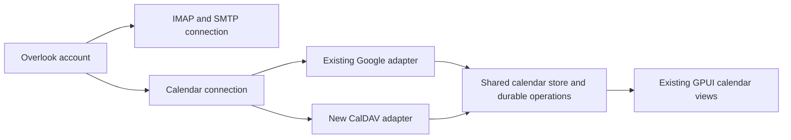

# Calendars for IMAP Accounts

Implementation plan for Overlook 1.5.6, based on source revision `1c1e5bc`, updated 23 October 2026. Status: connection/discovery, read-sync/account UI, personal-event writes, offline operations, and conflicts are implemented. Live Fastmail qualification is in progress; meeting writes remain pending. See the [read-sync implementation record](fastmail-calendar-read-sync.md), [write-sync record](fastmail-calendar-write-sync.md), and [provider roadmap](calendar-provider-roadmap.md).

## Product outcome

An IMAP account should offer to connect its calendars during account setup and allow an existing account to connect calendars from Settings. Connected calendars should use Overlook's existing Day, Week, Month, and Agenda views, reminders, and event editor, including offline use and both Light and Dark themes.

IMAP synchronizes email; it does not provide a calendar service. Add **CalDAV alongside IMAP and SMTP**, with its own endpoint and authentication. A provider must expose a compatible calendar service for this to work. Receiving an invitation attachment through IMAP does not synchronize the associated calendar. See the [IMAP standard](https://www.rfc-editor.org/rfc/rfc9051.html) and [CalDAV standard](https://www.rfc-editor.org/rfc/rfc4791.html).

Treat mail and calendar as services linked to one account. Support different mail and calendar hosts and usernames. Calendar setup must not prevent an otherwise valid mail account from being saved or used.

## Fastmail as the first supported provider

The user's IMAP account is hosted by **Fastmail**. Make Fastmail the primary implementation and release acceptance target, while keeping the adapter standards-based for other CalDAV services.

| Setting | Fastmail preset |
|---|---|
| Discovery endpoint | `https://caldav.fastmail.com/` |
| Transport | HTTPS with certificate verification |
| Username | Full Fastmail account username, including its domain; prefill the configured IMAP username and allow correction |
| Credential | Fastmail app password with calendar access; never the main account password |
| Manual fallback | The CalDAV URL shown under Fastmail Settings → Calendars → the calendar's Export action |

Fastmail documents two-way CalDAV synchronization and these connection settings. Use discovery to obtain actual collection URLs rather than constructing calendar paths from the email address. [Fastmail server settings](https://www.fastmail.help/hc/en-us/articles/1500000278342-Server-names-and-ports)

Recognize the existing `imap.fastmail.com` server as a suggestion to offer the Fastmail calendar preset, including for accounts with custom email domains. Also allow explicit Fastmail selection when the mail host or email domain does not identify the service. Show **Connect Fastmail calendars** in the setup flow and existing account's calendar empty state once Fastmail is selected or recognized.

Offer to reuse the stored mail app password only after the user selects the Fastmail calendar service, and verify it against the calendar endpoint. Mail authentication succeeding does not establish calendar permission. If calendar access is denied, preserve working mail and offer a separate calendar app password. Fastmail's **Mail, Contacts & Calendars** app-password option includes CalDAV; an existing password's permissions can be reviewed, but the password cannot be edited in place. [Fastmail app passwords](https://www.fastmail.help/hc/en-us/articles/360058752854-App-passwords)

No new Google authorization is involved in the planned Fastmail connection. Implement using CalDAV and the app password, and keep the current Google Calendar connection available for Gmail accounts.

## Scope and release sequence

| Delivery | Included |
|---|---|
| First release | CalDAV discovery and manual setup; multiple existing calendars per connection; permissions; event reading, creation, editing, and deletion; recurrence display and supported edits; reminders; durable offline changes; conflict recovery; independent mail and calendar status |
| Meeting support follow-up | Invitations, updates, cancellations, and Accept/Tentative/Decline through verified CalDAV scheduling, plus an email scheduling path where the server does not deliver invitations |
| Later | This-and-following recurrence edits, remote calendar creation/deletion and sharing administration, standalone calendar accounts, multiple calendar services linked to one mail account, subscription feeds, CardDAV contacts, tasks, and a Microsoft Graph adapter |

The first release supports personal appointments and safely displays meetings. CalDAV events with attendees remain read-only until scheduling is implemented: even an ordinary edit or delete can trigger server-generated invitations or cancellations. It must not offer attendee changes, RSVP, or invitation sending until the corresponding scheduling path is implemented and tested. Existing Google Calendar capabilities remain available.

Use the same attachment model for POP3 accounts when practical, but IMAP is the acceptance target. Gmail continues using its existing Google Calendar adapter; this project does not change Google's OAuth scopes or the submitted CASA assessment.

## Starting implementation and gaps

This table describes the starting revision. The implementation record at the end tracks changes as they land.

| Code | Current behavior | Required change |
|---|---|---|
| `crates/overlook-app/src/providers.rs` | `AccountProviders` already has separate mail and optional calendar providers; `imap_providers` explicitly sets `calendar: None` | Build the calendar adapter from a separate saved connection; represent mail and calendar initialization failures independently |
| `crates/overlook-provider/src/calendar.rs` | Shared `CalendarProvider` trait with reads, writes, RSVP, recurrence scopes, and free/busy | Add capabilities, conditional writes, resource metadata, and explicit unsupported-operation results |
| `crates/overlook-app/src/ui/calendar.rs` | Unconditional Gmail-only banner for IMAP/POP3; Google-style event IDs allocated in the editor | Show connection state and setup actions; allocate remote identity through the appropriate adapter |
| `crates/overlook-core/src/calendar.rs` | Useful event display model, but primarily timestamps and expanded occurrences | Preserve original calendar date/time and recurrence semantics separately from display projections |
| `crates/overlook-core/src/ics.rs` | Minimal parser for the first invitation VEVENT | Add a complete calendar-resource codec; retain a small invitation API backed by safe parsing |
| `crates/overlook-store/src/lib.rs` and `schema.rs` | Calendar/event cache and durable operations; schema currently V12 | Add connection, CalDAV resource, checkpoint, and operation-version storage with atomic reconciliation |
| `crates/overlook-app/src/sync.rs` | Shared operations; calendar reads occur after mail probing/downloading; some calendar write failures break shared replay | Give calendar work independent scheduling, retry state, and queue processing |
| `crates/overlook-app/src/ui/account_setup.rs` and `settings.rs` | IMAP setup configures incoming/outgoing mail only | Add calendar discovery, connection editing, collection selection, and credential repair |
| `crates/overlook-app/src/ui/reader.rs` | Invitation cards expect matching events to appear after sync | Match recurring invitations precisely and show truthful actions when no event or scheduling service exists |

Two existing sync assumptions need particular attention. `replace_calendars` deletes collections absent from a returned list, so an incomplete discovery response cannot be treated as a complete inventory. Event changes and their sync token are currently persisted separately, and remote deletions are not filtered by the pending-event protection applied to upserts. CalDAV reconciliation must preserve local edits and commit remote state with its checkpoint atomically.

## Account setup and daily use

### New accounts

1. Complete and validate the existing IMAP/SMTP setup.
2. Offer **Connect calendars** and start bounded, cancellable discovery. Show a separate calendar progress row while mail remains usable.
3. When a service is found, display its hostname, suggested username, and available authentication method. Offer **Use mail sign-in** only after the user selects that service; otherwise request a separate password or app password.
4. Test calendar access, then list available calendars with names, colors, and read-only indicators. Let the user choose calendars to sync and a default writable calendar.
5. Save the connection and begin downloading. Show **Calendars connected** only after discovery, authentication, and collection access succeed. Initial downloading has its own progress state.

Always provide **Set up manually** and **Skip for now**. A provider may require an app password with calendar permission even when mail already works; for example, Fastmail documents separate app-password access choices for mail, contacts, and calendars. [Fastmail app passwords](https://www.fastmail.help/hc/en-us/articles/360058752854-App-passwords)

### Existing accounts

Add Settings → Accounts → selected account → **Calendars** with Connect, Discover, Server URL, Username, Update password, Test connection, selected calendars, default calendar, last successful sync, and Disconnect.

Replace the Gmail-only banner with **“Connect a calendar service to use calendars with this account.”** and **Connect calendars**. Use distinct messages for discovery failure, authentication failure, offline cached data, no calendars selected, read-only calendars, and pending conflicts. Do not label a temporary failure as “this account has no calendar.”

Reuse existing theme tokens, controls, keyboard navigation, calendar colors, and layouts. Hide Google Meet generation for CalDAV; existing conference links remain usable. Free/busy, guests, RSVP, and recurrence scopes follow capabilities, including in keyboard commands and drag/drop handlers.

## Architecture and persistence

Keep `Account.provider` as the mail-provider choice. Add `CalendarConnection` with a stable ID, account ID, kind, enabled state, endpoint, username, authentication mode, discovered principal/home URLs, approved credential origins, and connection generation. Initially allow one active calendar connection per account, containing many calendar collections. Keep passwords and tokens out of this record.

Add capability data at connection and collection level: read, create, update, delete, scheduling mode, free/busy, supported recurrence edits, and conference creation. Server permissions remain authoritative. Extend the existing trait rather than build a second calendar UI. Its current scoped-operation defaults must not silently turn an unsupported series edit into a single-event edit.

Suggested new persistence, with exact migration numbers assigned when implementation starts:

| Record | Purpose |
|---|---|
| `calendar_connections` | Configuration and service identity, linked to the mail account |
| Calendar connection reference | Scope each existing calendar row to its connection; preserve stable IDs and visibility preferences |
| `caldav_resources` | Collection ID, resource URL, UID, ETag, optional scheduling tag, original iCalendar content, parsed revision, and deletion state |
| Calendar sync state | Per-collection token, completed coverage intervals, inventory generation, and last successful sync |
| Calendar operation payload | Immutable intended change, base version/content, resource identity, local revision, dependencies, and outcome state |

An iCalendar resource can contain a recurring master and exception components. Store it once and derive the occurrences used by the existing views. Do not assign the same resource URL as the unique `provider_id` of every expanded event: the current `(calendar_id, provider_id)` unique index requires distinct occurrence identity. Key projections by connection, calendar, UID, and recurrence ID; keep resource URLs separate.

Backfill Google/sample connection records without changing existing event IDs, credentials, pending operations, or sync tokens. Existing IMAP accounts start without a calendar connection and receive the setup action. Apply each migration and its version update together; test restart after interrupted migration and refuse databases newer than the running binary supports.

Reuse the OS keyring with a connection-specific secret kind under the owning account. Explicit credential reuse can reference the incoming-mail secret; a failed keyring read must not fall back to another credential. Disconnecting calendars removes only their configuration, cache, and owned secrets after resolving unsynced changes; it does not delete server events or the mail password. Account removal invalidates all service generations and stops in-flight work before cleanup. Explain that deleting a stored app password does not revoke it at the remote provider.

## Discovery and CalDAV adapter

Create `crates/overlook-provider/src/caldav/` with transport, discovery, XML mapping, resource codec, and adapter modules.

The first adapter supports HTTP Basic authentication over verified HTTPS, using a password or provider-issued app password. Other authentication schemes require explicit adapter work and compatibility tests; show an actionable unsupported-authentication result rather than repeatedly retrying credentials. Keep Google's existing OAuth implementation for Google Calendar.

Discover from an explicit URL, maintained provider presets, or the email domain using secure DNS service records and `/.well-known/caldav`. Resolve the current user principal and calendar home, then enumerate calendar collections and permissions. Accept server, principal, home, and collection URLs in manual setup. Honor SRV priority/weight and advertised context paths rather than guessing usernames into URLs. These discovery mechanisms are defined in [RFC 6764](https://www.rfc-editor.org/rfc/rfc6764.html).

Use `PROPFIND`, `calendar-query`, and `calendar-multiget` to discover and retrieve resources. Parse namespace-qualified XML and individual `207 Multi-Status` results, including relative URLs and per-resource errors. Use conditional PUT/DELETE with stored ETags; create at a durable client-chosen resource name with `If-None-Match: *`. Follow the [CalDAV resource and write model](https://www.rfc-editor.org/rfc/rfc4791.html).

Prefer `sync-collection` where supported; otherwise reconcile a completed resource inventory using URLs and ETags. A rejected/expired token triggers a fresh inventory without losing pending changes. Persist each complete sync batch and its checkpoint in one transaction; never advance past unrecorded failures. [WebDAV collection synchronization](https://www.rfc-editor.org/rfc/rfc6578.html)

Start with the existing Google coverage window of 60 days back and 366 days forward. Track coverage explicitly and extend it when the user navigates outside it. Keep full masters/exceptions needed to reproduce recurring events offline. Separate a complete collection inventory from a date-filtered result: leaving a time window is not proof of deletion. Preserve previously cached periods and identify uncached periods when offline. Treat visibility and subscription as separate choices; hiding a calendar must not strand pending writes.

Use the existing `ureq`/Rustls approach and background execution. Select a namespace-aware XML parser and an iCalendar/recurrence implementation during the first milestone, checking license, maintenance, malformed-input handling, and lossless round trips. Do not grow the current invitation parser into a full protocol implementation through ad hoc string splitting.

### Transport boundaries

Require HTTPS with certificate and hostname verification. Support self-hosted private endpoints explicitly configured by the user, including valid private-CA deployments; do not copy the remote-email-image policy that blocks all private addresses. Plaintext is restricted to isolated loopback test fixtures.

Discovery candidates and redirects are untrusted. Never forward mail credentials or Authorization headers to an unapproved origin. Resolve cross-origin authentication through a reviewed provider preset or a clear user-selected endpoint, including legitimate provider shard redirects. Reject TLS downgrades, URL-embedded credentials, and unsupported URL schemes. Bound redirects, timeouts, response size, XML nesting, calendar component count, and recurrence expansion; disable external entities and external resource fetching. Redact credentials, event content, and secret URL components from diagnostics.

## Calendar correctness

Preserve dates, UTC instants, floating times, TZIDs, supplied timezone definitions, all-day exclusive end dates, recurrence rules, exception dates, recurrence IDs, attendees, organizer, sequence, alarms, and unknown extension properties. Do not reconstruct the entire remote resource from the current simplified `Event` fields. The calendar format and recurrence semantics are defined by [iCalendar RFC 5545](https://www.rfc-editor.org/rfc/rfc5545.html).

Retain `Event.start` and `end` as display/index projections where useful, but keep original temporal values as the source of truth. Travel or a system timezone change must not move a date-only event onto another day. Project recurring instances over a bounded requested range; never expand an unbounded series indefinitely.

First-release recurrence editing supports **This event** and **All events** only for structures the implementation can safely round-trip. Updating one occurrence edits an exception in the existing resource; removing it excludes that occurrence without deleting the entire series. Preserve other exceptions when editing the master. Unsupported recurrence or custom timezone data remains intact and is visibly read-only when it cannot be interpreted safely. **This and following events** stays hidden until series splitting has dedicated tests.

Map supported display alarms into Overlook reminders. Preserve unfamiliar alarm types without executing them. Shared/read-only calendars remain visible, with permissions enforced by both the UI and the provider.

## Offline edits and service isolation

Keep existing local-first behavior: commit the visible change and durable operation together before reporting it saved. Extend the operation model so replay uses a captured intended change and base revision rather than whichever event row happens to exist later.

Split mail/contact replay and calendar replay into independently scheduled work. Mail credentials, mail probing, and mail backoff must not gate calendar-provider construction or calendar sync. Calendar failures must not stop SMTP or mail mutations. Each service needs its own in-flight guard, retries, sign-in state, and last-sync time. Preserve ordering within an event/resource and its dependent operations; unrelated work can progress. Keep a user-requested global offline mode effective for all services.

All background results carry account/connection ID, generation, and operation revision. Apply results only if the connection and pending revision still match, including database commits, so account switching, reconnecting, removal, or a newer edit cannot be overwritten by a late response.

| Situation | Required behavior |
|---|---|
| Offline create/edit/delete | Available immediately from local storage; pending changes survive restart |
| Network returns | Reconcile remote versions, then replay ordered changes with conditional requests |
| Event changed remotely | Preserve base, local, and remote versions; show a conflict with keep-remote, reviewed keep-local, or save-copy choices |
| Server deleted a locally edited event | Keep the local version recoverable; offer save as a new event or discard rather than silently resurrect it |
| PUT response was lost | Check the known resource URL/UID and content before retrying; do not create a second event |
| DELETE response was lost | Verify resource absence; a confirmed missing resource completes the deletion |
| Permission/authentication failure | Preserve queued changes and cached events; repair the calendar connection without interrupting mail |
| One collection fails | Retain its checkpoint and show its error; continue independent collections |

Protect pending edits and deletes from both remote upserts and remote tombstones. Reconcile an authoritative resource snapshot in a transaction, then rebuild projections; incomplete scans or parse failures cannot delete cached data. A successful older operation must not clear a newer pending revision.

Expose **Saved on this device**, **Waiting to sync**, **Synced**, **Needs attention**, and **Outcome unknown** accurately. Provide a recovery surface for failed or uncertain operations rather than leaving an event permanently marked pending.

## Meeting invitations and RSVP follow-up

Calendar storage and invitation delivery are different capabilities. Detect server scheduling support and implement it explicitly, including scheduling tags and organizer/attendee roles. A successful calendar write alone must not be presented as confirmation that an invitation was delivered. [CalDAV scheduling RFC 6638](https://www.rfc-editor.org/rfc/rfc6638.html)

Extend invitation parsing/matching to include UID, recurrence ID, organizer, sequence, and method. An invitation received through IMAP may not already exist on the calendar: offer a destination calendar and import/respond workflow when supported. Validate organizer updates and the user's attendee identity; never turn arbitrary calendar attachments into automatic outgoing mail. Follow [iTIP scheduling semantics](https://www.rfc-editor.org/rfc/rfc5546.html).

For servers without invitation delivery, add an explicit iMIP path over the account's existing SMTP service. It sends REQUEST/REPLY/CANCEL messages with appropriate MIME and calendar metadata. Model calendar persistence and outgoing mail as dependent durable steps with separate outcomes, stable IDs, and the existing uncertain-send recovery rules. Never invoke both server scheduling and SMTP delivery for the same invitation. [iMIP over email](https://www.rfc-editor.org/rfc/rfc6047.html)

Until this milestone is complete, hide unsupported RSVP/guest controls and replace “It will appear after the next calendar sync” with wording reflecting the actual connection and invitation state. Free/busy must return unknown when unsupported; it must not imply that an attendee is available.

## Implementation milestones

| Milestone | Work | Exit condition |
|---|---|---|
| M0 Protocol and library validation | Use Fastmail as the confirmed hosted target; choose codec/XML/recurrence dependencies; exercise the Fastmail discovery preset and a resource round trip against isolated CalDAV fixtures and a reference server | Recorded Fastmail connection contract, dependency/license decisions, and working read/write/recurrence experiment; no production account data required |
| M1 Connection model and service separation | Core types, migrations, keyring handling, capabilities, provider assembly, independent scheduling and operation routing; adapt Google/sample providers | Existing Gmail calendar and IMAP mail regressions pass; calendar can run when mail is unavailable and vice versa |
| M2 Discovery and read synchronization | CalDAV transport, setup/settings, collection selection, resource cache, recurring projections, incremental/full reconciliation, coverage, reminders | An existing IMAP account can connect calendars, display remote changes/deletions, restart offline, and render cached events in all views |
| M3 Durable writes and conflicts | Immutable operations, conditional CRUD, recurrence scopes, reconciliation after lost replies, conflict UI, disconnect recovery | Two-way personal calendar use survives disconnection, restart, concurrent edits, and server failures without lost or duplicate events |
| M4 First release qualification | Real provider interoperability, native UX/accessibility, Light/Dark checks, docs and release notes | All first-release acceptance checks below pass; supported providers/capabilities are documented from observed tests |
| M5 Meeting support | Server scheduling, mail invitation matching, RSVP, SMTP fallback, and delivery status | Invites, replies, changes, and cancellations work between real clients without double sending; unsupported paths remain clearly unavailable |

M0 → M1 → M2 → M3 → M4 is the first-release sequence. M5 is a separate release so invitation delivery does not delay reliable personal calendar synchronization. Calendar schema, codec, and operation design in M0/M1 must accommodate M5.

## Validation and release acceptance

Use deterministic CalDAV fixtures for malformed XML/iCalendar, relative URLs, cross-origin discovery, credential leakage, permission failures, expired tokens, paged or partial sync, missing resources, invalid certificates, rate limits, and timeouts. Exercise multiple calendar resources sharing UIDs across accounts without collisions.

Calendar fixtures must cover daylight-saving transitions, floating and UTC times, all-day/multi-day events, travel between zones, weekly/monthly recurrence, exclusions, moved occurrences, custom timezone definitions, unknown properties, and alarms. Editing a title must leave unrelated fields and exception components intact.

Store/sync tests must include offline create→edit→delete, restart and process termination at durable boundaries, server-write success followed by lost acknowledgment, stale results after reconnect/removal, local edits versus remote deletion, failed collection listings, and independent mail/calendar failures. Migration tests include existing Google events and queued operations.

Qualify **Fastmail as the required hosted service**, plus a controlled self-hosted server to catch assumptions specific to Fastmail. Nextcloud is a candidate for the second implementation; its documentation describes CalDAV client setup. Provider support is a test target until observed, not a promise inferred from IMAP access. [Nextcloud calendar setup](https://docs.nextcloud.com/server/stable/user_manual/en/groupware/sync_thunderbird.html)

Fastmail acceptance must specifically cover:

- [ ] Connect calendars to the existing Fastmail IMAP account without recreating it, including a custom-domain account and a corrected login username.
- [ ] Reuse an app password with calendar access; reject a mail-only app password with useful recovery wording while mail keeps working.
- [ ] Discover multiple calendars and respect permissions on shared calendars where available.
- [ ] Compare create/edit/delete, recurring exceptions, all-day events, and timezone changes between Overlook and Fastmail's web calendar using dedicated test events.
- [ ] Edit offline, restart, reconnect, and resolve an overlapping edit made in Fastmail's web calendar without loss or duplication.
- [ ] Disconnect and reconnect only the calendar service without disturbing IMAP/SMTP or duplicating cached calendars.

M5 additionally verifies invitation delivery, replies, and cancellations through Fastmail with controlled recipients before enabling those controls. Do not infer scheduling support from a successful personal-event round trip.

iCloud is an additional compatibility target with app-specific authentication to verify. Microsoft's calendar integration belongs in a separate Graph adapter rather than being assumed from an IMAP connection. [Apple app-specific passwords](https://support.apple.com/en-ie/102654), [Microsoft Graph calendar API](https://learn.microsoft.com/en-us/graph/outlook-calendar-concept-overview)

First-release acceptance:

- [ ] New and existing IMAP accounts can connect a supported calendar service without removing or recreating their mail account.
- [ ] Discovery failure has a manual path and never sends credentials to an unapproved host.
- [ ] Multiple selected calendars retain colors, visibility, permissions, and default-calendar choices across restart.
- [ ] Create, edit, delete, and supported recurrence edits synchronize in both directions with another client.
- [ ] Offline changes survive restart; stale responses, expired tokens, and conflicts do not lose edits or duplicate events.
- [ ] Events outside cached coverage are distinguished from an empty calendar while offline.
- [ ] Mail continues during calendar failure; calendar continues during mail failure.
- [ ] Google Calendar remains functional, including its existing meeting features and pending operations.
- [ ] Both themes, keyboard-only setup/editing, error focus, accessible labels, and narrow-window layout are checked in the actual native application.
- [ ] Disconnect and account removal stop background work and clean only the intended local data/secrets.
- [ ] Real-service interoperability results, limitations, and recovery steps are recorded in the native app guide and release notes.

Run meaningful core/provider/store tests throughout implementation and workspace tests, Clippy, formatting, and native checks for the release candidate. Record existing failures separately. Native UI verification is required when account setup or calendar views change.

## Follow-up documentation

Update `llm-docs/overlook-native-app.md`, the product plan, and user-facing setup documentation as milestones land. Add CalDAV data flows, keyring lifecycle, new parser dependencies, and transport protections to a new security evidence revision; preserve the already submitted CASA evidence as a historical snapshot. Do not claim TAC reviewed later changes.

## First increment record — 22 October 2026 (historical)

At the end of the first bounded increment, parts of M0/M1/M2 were implemented; the event codec, sync service, scheduler, and setup UI were still pending. The second increment below supersedes that status.

| Area | Implemented |
|---|---|
| Core | `CalendarConnectionId`, `CalDavSettings`, an explicit incoming-mail versus separate credential reference, stable connection identity, and configuration generation. HTTPS/username validation runs without network access. Secrets are not part of the settings record. |
| Store | V13 adds one CalDAV connection per account. Saving requires the expected generation and atomically rejects stale configuration. Settings survive restart and cascade on account deletion. Future schema versions are rejected before journal-mode changes. The V13 DDL and version marker commit together. |
| Provider | `caldav::fastmail_preset` recognizes the actual incoming Fastmail host, including custom-domain accounts. `CalDavClient::discover` follows principal/home URLs and returns VEVENT collections, names, colors, reported permissions, and collection-sync support. Manual server/home/collection URLs use the same discovery path. |
| Transport | Verified HTTPS, Basic authentication, manual same-origin redirects, no credential forwarding to other origins, bounded requests/responses/XML, DTD rejection, namespace-aware parsing, and errors without raw server bodies or credential-bearing URLs. A failed home listing fails the whole inventory. |
| Tests | 19 new tests across core, store, and provider cover configuration validation, persistence and stale saves, account cleanup, V12 migration, newer-schema rejection, discovery, permissions, HTTP errors, XML safety, redirect boundaries, and actual TLS verification. |

The configured endpoint is the only approved credential origin in this increment. Cross-origin discovery/redirects return an actionable error; reviewed shard support and user-approved origin expansion remain future work. DNS/SRV and well-known discovery, custom CA configuration, keyring writes/deletion, persisted discovered collections, Google connection backfill, and cancellation/UI generation guards also remain pending. The existing Google/sample connections still operate implicitly. No production account or credential was used for these tests.

Dependency decisions for this increment: reuse `ureq` 3.4.2/Rustls for transport; use `roxmltree` 0.21.1 for namespace-aware XML and `url` 2.5.8 for origin-safe URL resolution. Both newly referenced parser libraries declare MIT OR Apache-2.0 licenses and were already in the workspace lockfile; no new package versions were introduced. iCalendar and recurrence dependency selection remains open and must include a lossless round-trip experiment before writes are implemented.

Validation: `cargo test --workspace --offline` passed **313 tests**, with **26 ignored**. `cargo clippy --workspace --all-targets --offline` passed with existing warnings and no new-module diagnostics. The new modules pass `rustfmt --check`; `cargo fmt --all -- --check` still fails on widespread existing formatting differences. No native UI verification was needed for this backend-only increment. These results do not establish live Fastmail compatibility.

## Second increment record — 22 October 2026

Read synchronization and existing-account UI are implemented. The [read-sync implementation record](fastmail-calendar-read-sync.md) documents the parser, original resource retention, server-expanded recurrence, bounded reports, V14 cache/coverage tables, independent scheduling, keyring lifecycle, cancellation guards, and read-only controls. The [provider roadmap](calendar-provider-roadmap.md) records validation results and remaining qualification. Full milestones and release acceptance remain open where they require writes or live-service testing.

Next: qualify the read path against Fastmail and a reference server using credentials entered by the user in the application. Then complete lossless resource round-trip experiments and durable conditional writes, offline operations/conflicts, and safe recurrence edits. Invitation delivery remains a separate milestone. New accounts can connect calendars after mail setup through Settings → Accounts; automatic calendar discovery within the mail setup wizard remains pending.

## Third increment record — 22 October 2026

Personal-event CRUD, the V15 durable resource outbox, conditional uploads, restart/unknown-result reconciliation, and conflict review are implemented. See [Fastmail calendar writes](fastmail-calendar-write-sync.md) for the exact behavior and validation. This completes the implementation portion of M3 for personal appointments, subject to live provider qualification. Recurring single-occurrence edits/cancellations and whole-series deletion are enabled; whole-series editing and following-series splits remain deferred. Meeting scheduling/RSVP, hosted Fastmail/reference-server qualification, and wizard integration remain open.

The resumed verification completed with **346 tests passed, 28 ignored**, a successful release build and Clippy check, and native Light/Dark offline CRUD, forced-kill persistence, and conflict-choice checks. The POP3 failure was traced to a test-server transcript publication race and fixed. Repository-wide formatting still reports existing differences; new modules pass formatting checks. See the [completed verification handoff](fastmail-writes-handoff.md) for evidence, cleanup, and the remaining live-service/accessibility qualification. The first-release acceptance checklist remains open wherever it requires those broader checks.

## Fourth increment record — 23 October 2026

New Fastmail IMAP account setup now offers an explicit calendar-password reuse choice, followed by independent background discovery. The native editor and headless tests share durable save/resolve commands. A stateful loopback HTTPS service exercises those commands with the actual transport/parser, coordinator and SQLite through offline CRUD, reopen, both conflict choices, authentication recovery and lost write replies. Full workspace validation passes 354 tests with 28 ignored. See [onboarding and workflow verification](fastmail-onboarding-and-workflows.md).

The user has ended guided testing and requested continued autonomous development. Do not assign more manual scripts; use isolated tests and record their limits. Live connection and online edits passed in both directions, while hosted offline/conflict acceptance remains inconclusive. The fifth increment below supersedes the implementation items still open at this point.

## Fifth increment — personal-calendar completion, 23 October 2026

Collection-level RFC 6578 synchronization, V16 atomic checkpoints, persistent default-calendar selection and read-only settings indicators are implemented. Unchanged collections reuse the valid cache; changed/expired/partial collections use complete bounded queries. Per-resource delta fetching remains a performance optimization, not part of this increment. Existing personal CRUD, offline outbox and conflict behavior are unchanged. Calendar dragging and multi-day display now respect date boundaries across DST.

Independent Radicale 3.8.3 qualification passed over verified loopback TLS, including two calendars, recurrence expansion, occurrence editing/cancellation, CRUD, restart, property preservation and both conflict choices. The workspace suite passes 358 tests with 29 ignored; the reference test passed separately, as did calendar workflows and dragging under Europe/Berlin. Clippy and release build pass. See [completion and evidence](fastmail-calendar-completion.md).

The implementation is ready for normal-use evaluation as personal calendars. M4's complete acceptance checklist remains open for fresh native visual/accessibility and broader hosted qualification; headless results do not satisfy those observations. Native app control was unavailable in this session, and the user has declined guided live-account testing. Earlier observed checks remain recorded in their handoffs. Meeting support is still M5; new recurrence rules, whole-series editing and following-series splits remain outside the supported editing scope.
